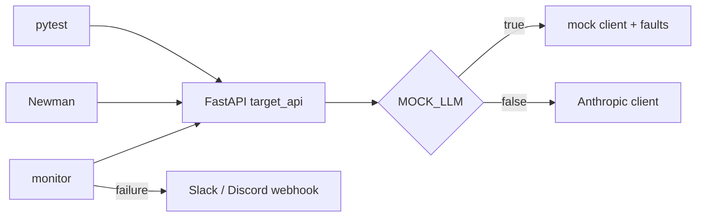

# ai-api-test-suite


<!-- Replace OWNER with your GitHub username once the repo is pushed. -->

A small LLM-backed REST API (`POST /v1/summarize`) plus the tooling a team uses to catch failures in
AI-backed APIs before customers do: a pytest suite, a Postman/Newman contract suite, a scheduled monitor
with webhook alerts, and a runbook mapping each failure to a fix. All synthetic data; the whole suite runs
offline with a deterministic mock LLM.

## Architecture

More detail: [docs/architecture.md](docs/architecture.md). Failure modes: [docs/faults.md](docs/faults.md).

## Run it
```bash
make install          # venv + dependencies
make test             # pytest in mock mode, with coverage
make run              # API on :8000 (leave running)
make newman           # in another terminal; needs: npm i -g newman newman-reporter-htmlextra
make monitor          # smoke checks against BASE_URL (default http://127.0.0.1:8000)
```
Copy `.env.example` to `.env` for reference; the Makefile defaults to synthetic keys, so none of this needs secrets.
Live mode (optional): set `MOCK_LLM=false` and `ANTHROPIC_API_KEY`, then `pytest -m live`.

## API
- `POST /v1/summarize` with `X-API-Key`, body `{"text": 1-5000 chars, "max_words": 10-200}` returns `{summary, model, latency_ms, request_id}`.
- `GET /health` returns `{status, mode}`.
- Errors: 401 missing key, 403 invalid key, 422 validation, 429 rate limited (`Retry-After`), 502 upstream failure or unusable output, 504 timeout. All use `{"error": {"code", "message", "request_id"}}`.

## What is tested
`tests/` covers auth, schema validation, rate limiting, timeouts, malformed input (bad JSON, unicode, huge strings, null bytes), the
LLM output contract (non-empty, within `max_words`, same script as input, no prompt leak; structure not exact text), the injected
faults, and the monitor itself. Postman/Newman mirrors the key scenarios against a live server.

Results as last run locally: 82 pytest tests passing, 92% coverage of `target_api` (the uncovered lines are the live Anthropic client,
which mock-mode tests cannot reach); Newman 41 requests / 45 assertions, 0 failures.

## Add a test
1. Add a function `test_...` to the matching file in `tests/` (or a new `tests/test_*.py`).
2. Use the `client`, `headers` and `payload` fixtures from `tests/conftest.py`; use `assert_error(resp, status, code)` for error responses.
3. Reproduce an upstream failure with `headers={**headers, "X-Fault": "bad_json"}` (faults are enabled in tests).
4. Mark tests that call the real model with `@pytest.mark.live`; they are skipped by default.

## How alerts work
`make monitor` hits `/health` and a real `/v1/summarize` call, checks the response contract and latency (`MAX_LATENCY_MS`), appends
each failure to `monitor/failures.jsonl`, and posts to `ALERT_WEBHOOK_URL` (Slack or Discord). The same check will not alert again for
30 minutes (state in `monitor/alert_state.json`). `monitor.yml` runs it hourly on GitHub Actions using repository secrets
`MONITOR_BASE_URL`, `MONITOR_API_KEY`, `ALERT_WEBHOOK_URL`. Triage steps are in [RUNBOOK.md](RUNBOOK.md).

## Limitations
- The rate limiter is in-memory: single instance only, reset on restart, no shared state across workers.
- The invalid-key throttle keys on the direct client IP; behind a proxy all callers would share one address.
- Determinism comes from the mock; the live-mode tests are few and have not been tuned against a real model.
- The language check compares writing script only; it cannot tell apart languages that share a script.
- There is no hosted deployment: the scheduled monitor only watches a real service if you set `MONITOR_BASE_URL`; otherwise it starts the mock API inside the runner, which proves the monitor works, not that a service is healthy.
- Faults and live mode are separate: injected faults only affect the mock client.
