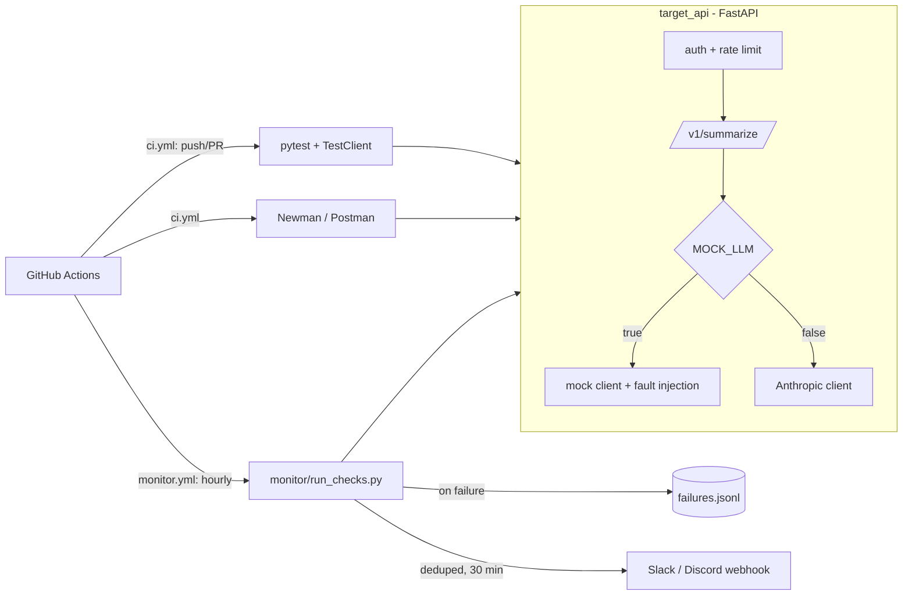

# Architecture

## Components
- **`target_api/main.py`**: routes, `X-API-Key` auth, in-memory sliding-window rate limiter, timeout, error handlers, request IDs.
- **`target_api/llm_client.py`**: `MockLLMClient` (deterministic: first `max_words` words) and `AnthropicLLMClient`, chosen once at import by `MOCK_LLM`.
- **`target_api/faults.py`**: `X-Fault` parsing, honored only with `ENABLE_FAULTS=true`. See `faults.md`.
- **`tests/`**: pytest against the app in-process with FastAPI's `TestClient`; no network, no server needed.
- **`postman/`**: contract tests run by Newman against a live local server.
- **`monitor/`**: smoke checks against any `BASE_URL`, failure log, de-duplicated webhook alerts.

## Request flow (`POST /v1/summarize`)
request id assigned → API key checked (401/403; invalid keys throttled per IP) → per-key rate limit (429) →
body validated (422) → LLM call under `REQUEST_TIMEOUT_SECONDS` (504) → upstream errors mapped to 502 →
empty summary rejected (502) → response.
